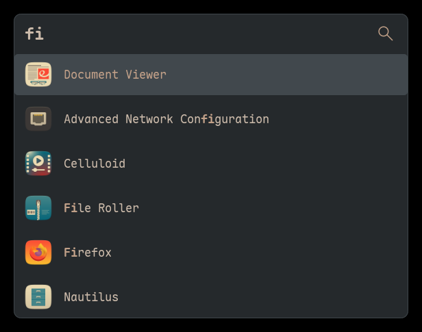

# rofi-spotlight

Launcher estilo Spotlight/Flow Launcher: só a barra de pesquisa ao abrir e a lista aparece enquanto você digita.
Baseado no [OutTheme](https://github.com/OuterFrog/outtheme-rofi-theme) (OuterFrog), com as cores do tema
**Traffic** (Gogh, dkeg), fonte **Maple Mono NF** e ícones **Gruvbox-Plus-Dark**. Feito para o rice do dwm (X11).



## Instalação

```sh
mkdir -p ~/.config/rofi/rofi-spotlight
cp config.rasi searchicon.svg ~/.config/rofi/rofi-spotlight/
rofi -show drun -theme ~/.config/rofi/rofi-spotlight/config.rasi
```

Requer rofi 1.7+, a fonte Maple Mono NF e o tema de ícones Gruvbox-Plus-Dark (ou troque `icon-theme`).

## Ajustes

| O quê | Onde (`config.rasi`) |
|---|---|
| Mostrar a lista já ao abrir | `listview { require-input: false; }` |
| Linhas visíveis | `listview { lines: 6; }` |
| Cores (Traffic) | `darkbg` `#282C30ed`, `lightbg` `#434A50ed`, `accent` `#C1A088`, `tcolor` `#CBBAAA` |
| Largura | `window { width: 30%; }` |

O fundo usa `transparency: "screenshot"`, que funciona sem compositor.
