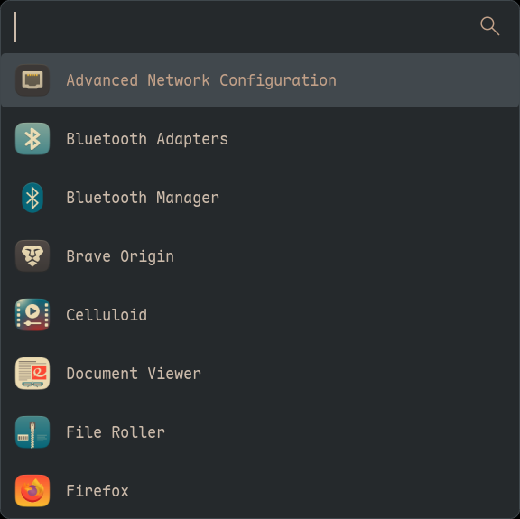
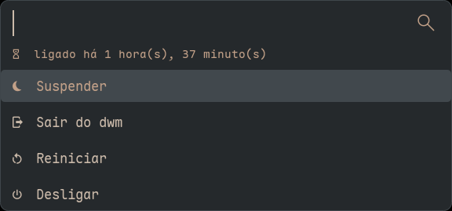
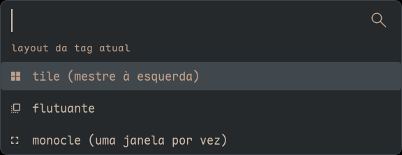
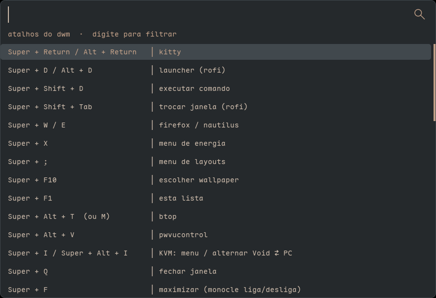
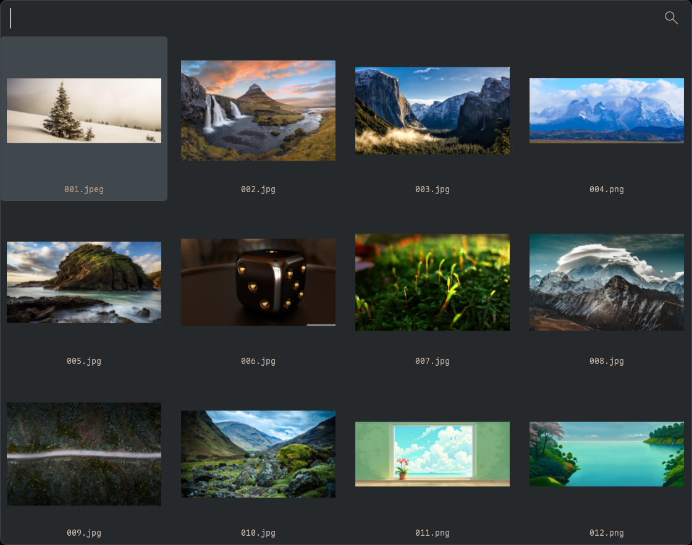

# rofi-top-01

Conjunto de rofis do rice do **dwm** (X11): launcher, energia, layouts, atalhos e wallpaper, todos no estilo
[OutTheme](https://github.com/OuterFrog/outtheme-rofi-theme) (OuterFrog) com as cores do tema **Traffic**
(Gogh, dkeg), fonte **Maple Mono NF** e ícones **Gruvbox-Plus-Dark**. Variante do [rofi-spotlight](../rofi-spotlight/)
em que o launcher já abre listando os apps.

| Launcher (Super+D) | Energia (Super+X) | Layouts (Super+;) |
|---|---|---|
|  |  |  |

| Atalhos (Super+F1) | Wallpaper (Super+F10) |
|---|---|
|  |  |

## Arquivos

| Arquivo | O quê |
|---|---|
| `outtheme.rasi` | tema base (launcher `drun`, com ícones) |
| `menu.rasi` | menus sem ícones, lista visível ao abrir (energia, layouts, `run`, `window`) |
| `hotkeys.rasi` / `wallpaper.rasi` | lista larga com rolagem / grade 4×3 de miniaturas |
| `searchicon.svg` | lupa na cor do destaque |
| `launcher.sh [drun\|run\|window]` | launcher (terminal: `$TERMINAL`, padrão kitty) |
| `powermenu.sh` | suspender, sair, reiniciar, desligar (`LOGOUT_CMD`, padrão encerra o dwm) |
| `layouts.sh` | tile / flutuante / monocle — específico do dwm: manda Super+Ctrl+F1/F2/F3 via xdotool |
| `hotkeys.sh` | lista de atalhos (edite a lista) |
| `wallpaper.py` | grade de `~/Imagens/wallpapers`, aplica com feh |

## Instalação

```sh
mkdir -p ~/.config/rofi/rofi-top-01
cp *.rasi *.svg *.sh wallpaper.py ~/.config/rofi/rofi-top-01/
```

Binds no `config.h` do dwm (exemplo):

```c
static const char *roficmd[]    = { "/bin/sh", "-c", "$HOME/.config/rofi/rofi-top-01/launcher.sh drun", NULL };
static const char *powercmd[]   = { "/bin/sh", "-c", "$HOME/.config/rofi/rofi-top-01/powermenu.sh", NULL };
static const char *layoutscmd[] = { "/bin/sh", "-c", "$HOME/.config/rofi/rofi-top-01/layouts.sh", NULL };
static const char *hotkeyscmd[] = { "/bin/sh", "-c", "$HOME/.config/rofi/rofi-top-01/hotkeys.sh", NULL };
static const char *wallcmd[]    = { "/bin/sh", "-c", "$HOME/.config/rofi/rofi-top-01/wallpaper.py", NULL };
/* layouts.sh precisa destes: */
{ MODKEY|ControlMask, XK_F1, setlayout, {.v = &layouts[0]} },
{ MODKEY|ControlMask, XK_F2, setlayout, {.v = &layouts[1]} },
{ MODKEY|ControlMask, XK_F3, setlayout, {.v = &layouts[2]} },
```

Requer rofi 1.7+, Maple Mono NF, Gruvbox-Plus-Dark (ou troque `icon-theme` no `outtheme.rasi`), feh e xdotool.
Cores no topo do `outtheme.rasi`: `darkbg` `#282C30ed`, `lightbg` `#434A50ed`, `accent` `#C1A088`, `tcolor` `#CBBAAA`.
