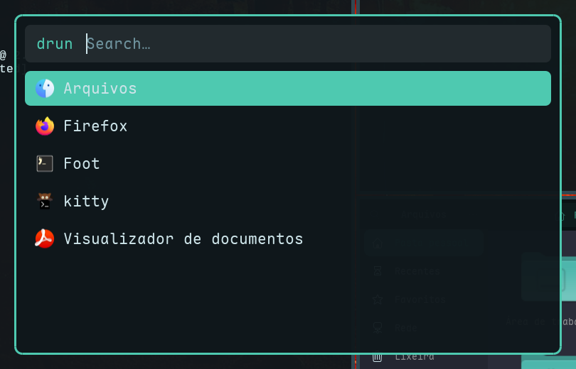
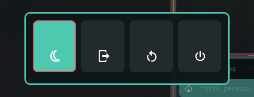
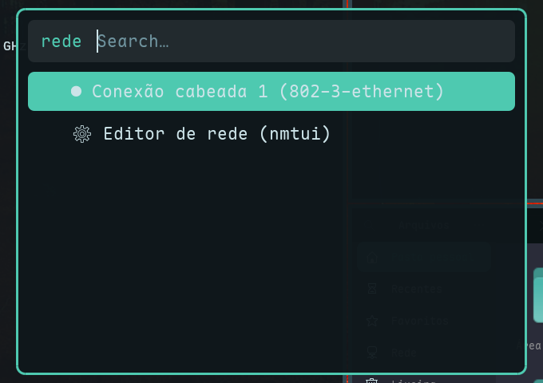
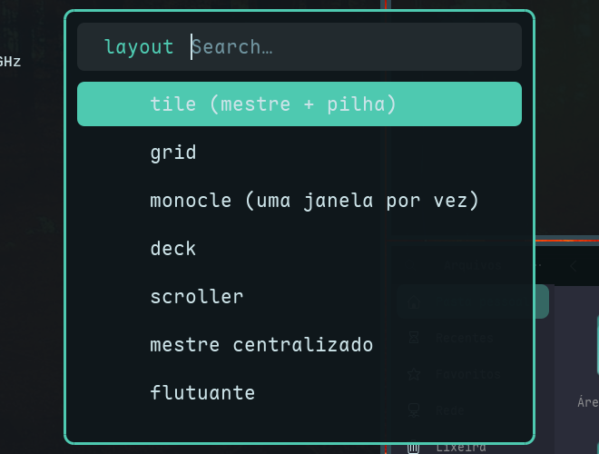
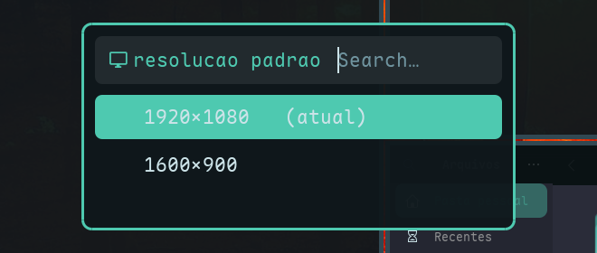
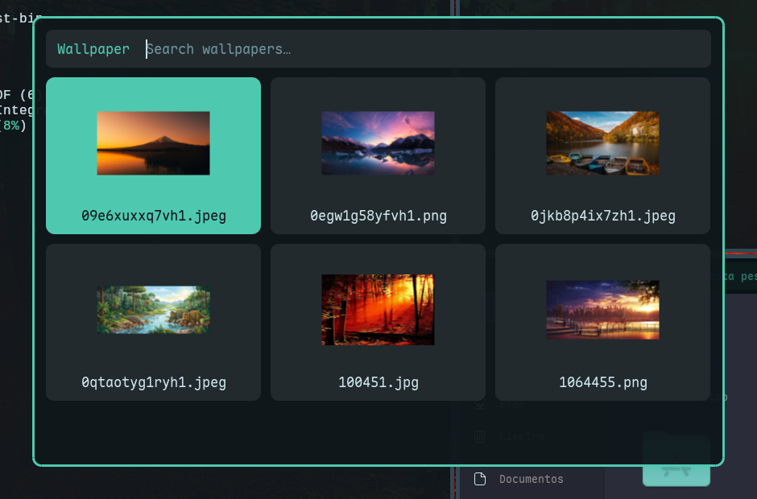
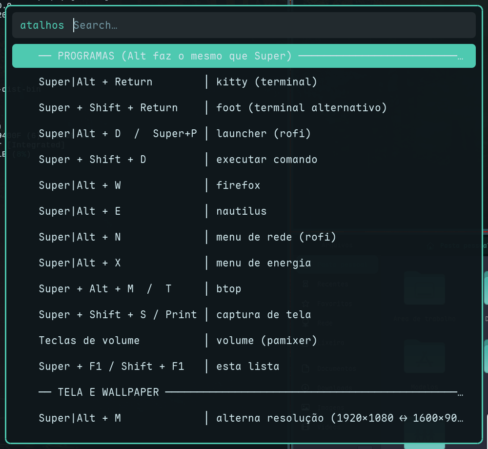
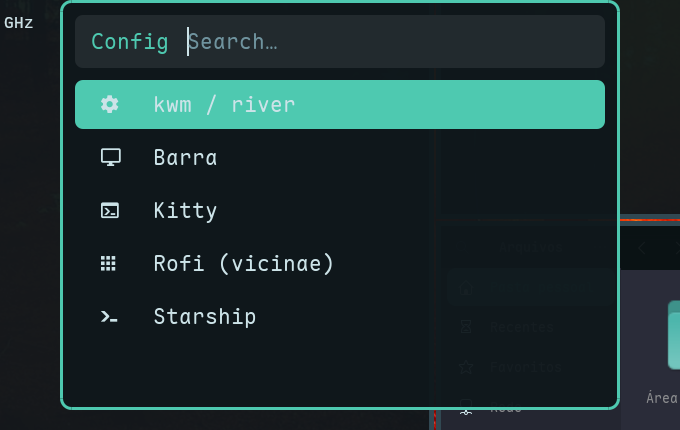
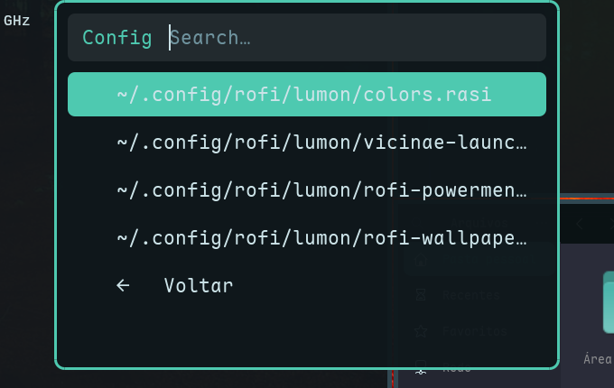

# rofi-vicinae

Menus de rofi no modelo **StratOS Vicinae** (janela com borda, barra de busca e lista arredondada), com a paleta **Lumon**
(`bg #0f181c`, `panel #222a2e`, `fg #cce3e8`, `accent #4ec9b0`). Fonte: Maple Mono NF CN (Nerd Font).
Usado no Gentoo RR (river + kwm, Wayland), mas e so rofi: serve em qualquer compositor.

## Estrutura
- `rofi/` — temas (`~/.config/rofi/lumon/`): `colors.rasi` (a paleta; trocar aqui muda tudo), `vicinae-launcher`, `rofi-powermenu`,
  `rofi-wallpaper-preview` (grade com miniaturas), `rofi-wallpaper-list`, `rofi-clipboard`, `rofi-settings` (menu Super+H, importa o launcher; adaptado do manager.rasi do one-arch-clean). O prompt tem fundo transparente (sem caixa branca).
- `scripts/` — menus (`~/.local/bin/`): `launcher` (drun), `rofi-powermenu` (icones Nerd Font brancos, sem texto), `rofi-network` (nmcli: conexoes,
  Wi-Fi, nmtui), `rofi-layouts` e `mon-set` (lista curta com o mesmo tema), `rofi-settings` (Super+H: abre os arquivos de config no editor: kwm, barra, kitty, rofi, starship; adaptado do `rofi-settings` do one-arch-clean), `rofi-hotkeys` (lista de atalhos) e `wallpaper.py` (seletor em grade).
- `original-stratos-tokyo-night/` — os arquivos originais do modelo (tokyo-night e latte) para comparar/restaurar.
- `preview/` — capturas reais (Gentoo RR, tema Lumon). Os previews do modelo original (tokyo-night) estao em `original-stratos-tokyo-night/`.

## Instalar
```bash
mkdir -p ~/.config/rofi/lumon ~/.local/bin
cp rofi/* ~/.config/rofi/lumon/
install -m755 scripts/* ~/.local/bin/        # wallpaper.py vai para ~/.config/rofi/wallpaper/ (ver abaixo)
```
Atalho tipico: `rofi -show drun -theme ~/.config/rofi/lumon/vicinae-launcher.rasi`.

## Notas
- Icones dos apps no launcher: `icon-theme: "McMuse-circle"` esta nos `.rasi` (troque pelo seu tema ou apague a linha).
- O powermenu usa glifos Nerd Font (lua, sair, reiniciar, desligar) com `LC_ALL=pt_BR.UTF-8` (precisa de UTF-8). Fonte 22 e janela 150 px:
  com fonte maior a lista some (nao cabe).
- Powermenu: `systemctl poweroff/reboot/suspend`; no systemd com mais de uma sessao ativa (greeter do SDDM) o logind pede autenticacao —
  libere o grupo wheel com uma regra polkit (`login1.power-off*`, `reboot*`, `suspend*`).
- `wallpaper.py` espera `/home/share/wallpapers` e chama `~/.local/bin/wallpaper-apply` (swaybg); adapte `folder` e a linha final.
- `mon-set`/`rofi-layouts` dependem de `wlr-randr`/`wtype` (Wayland) e do kwm; sao exemplos de uso do tema em listas curtas.
- Trocar de paleta: edite so `colors.rasi` (a original tokyo-night esta em `original-stratos-tokyo-night/colors.rasi`).

## Preview (tema Lumon, capturas reais)
| Launcher (`Super+D`) | Menu de energia (`Super+X`) |
|---|---|
|  |  |

| Rede (`Super+N`) | Layouts (`Super+;`) |
|---|---|
|  |  |

| Resolucao padrao (`Super+Shift+M`) | Wallpaper (`Super+F10`) |
|---|---|
|  |  |

Lista de atalhos (`Super+F1`):



Configuracoes (`Super+H`) e a lista de arquivos de uma area (abre no nvim dentro do kitty):

| Menu | Arquivos (ex.: Kitty) |
|---|---|
|  |  |
